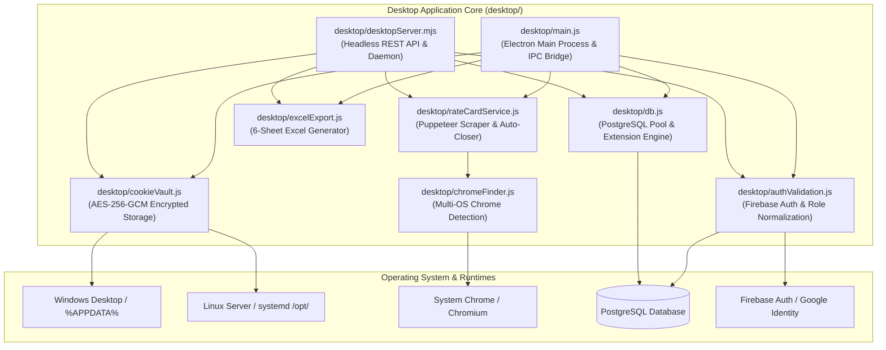

# ReconCentral: Desktop Worker & Database Extension Engine Specification

> **Target Audience**: Autonomous AI Agents, Senior Backend/DevOps Architects, and Full-Stack Engineers.  
> **Status**: Verified in Production & Packaged for Cross-Platform Release (Windows & Linux).  
> **Repository Scope**: `desktop/` directory, `released/` distribution directory, and backend synchronization bridges.

---

## 1. Executive Summary & Purpose

The **ReconCentral Desktop Worker & Extension Engine** is a cross-platform (Windows & Linux) application and headless daemon. It operates in two environments:
1. **Interactive Desktop GUI**: An Electron-powered desktop interface for operational staff at VB Exports to trigger rate card scraping, review detected fee changes, inspect live database tables, export 6-sheet Excel workbooks, and synchronize marketplace fee structures into PostgreSQL.
2. **Headless Background Daemon & CLI**: A Node.js daemon (`desktop/desktopServer.mjs` and `desktop/worker.js`) executing on Linux production servers or local worker nodes via systemd, providing REST endpoints, scheduled scraping, and automated database synchronization without requiring a display server.

### Key Capabilities
- **Self-Contained ASAR Packaging**: Completely isolated from backend runtime dependencies; zero relative path traversals into `../backend/`.
- **Database Query & Mutation Extension Engine**: Secure, parameterized read and batch upsert operations across strictly allowlisted PostgreSQL tables.
- **Dynamic Browser Detection**: Automatic discovery of system Google Chrome or Chromium binaries across Windows, Linux, and macOS without hardcoding paths.
- **AES-256-GCM Encrypted Cookie Vault**: Secure persistence of authenticated marketplace seller portal cookies with machine-derived hardware encryption keys.
- **Automated Rate Card Auto-Closing**: Mathematical closure of preceding rate card periods (`end_date = dayBefore(new_start_date)`) to guarantee database check constraint satisfaction (`(end_date IS NULL OR end_date >= start_date)`).
- **Zero-Secret Installer Architecture**: Zero hardcoded credentials or database connection strings in the packaged installer. Credentials are dynamically provisioned over TLS upon cryptographic Firebase Auth role verification.

---

## 2. Architecture & Component Decomposition



### Component Directory Mapping

| File Path | Primary Responsibility | Key Exported Symbols |
| :--- | :--- | :--- |
| [`desktop/main.js`](file:///c:/Users/Pawan%20Shukla/Desktop/DashBorad%20Project/desktop/main.js) | Electron main process, window lifecycle, IPC handlers for UI. | `mainWindow`, IPC channels |
| [`desktop/desktopServer.mjs`](file:///c:/Users/Pawan%20Shukla/Desktop/DashBorad%20Project/desktop/desktopServer.mjs) | Standalone HTTP REST server, SSE events, CLI headless runner. | `setDesktopTokenVerifier`, `resetDesktopTokenVerifier` |
| [`desktop/db.js`](file:///c:/Users/Pawan%20Shukla/Desktop/DashBorad%20Project/desktop/db.js) | Resilient PostgreSQL connection pool, query execution, table download/upload. | `getDesktopPool`, `downloadTableDetails`, `uploadTableUpdates`, `ALLOWED_TABLES` |
| [`desktop/authValidation.js`](file:///c:/Users/Pawan%20Shukla/Desktop/DashBorad%20Project/desktop/authValidation.js) | Cryptographic token verification, role normalization, claim validation. | `verifyDesktopTokenAuthorization`, `isAuthorizedDesktopRole`, `isAuthorizedMutationRole`, `normalizeRole` |
| [`desktop/cookieVault.js`](file:///c:/Users/Pawan%20Shukla/Desktop/DashBorad%20Project/desktop/cookieVault.js) | AES-256-GCM cookie encryption, user-data path resolution, permission enforcement. | `saveEncryptedCookies`, `loadEncryptedCookies`, `getResolvedUserDataDir` |
| [`desktop/chromeFinder.js`](file:///c:/Users/Pawan%20Shukla/Desktop/DashBorad%20Project/desktop/chromeFinder.js) | OS-agnostic discovery of Chrome/Chromium executable binaries. | `getChromeExecutablePath` |
| [`desktop/rateCardService.js`](file:///c:/Users/Pawan%20Shukla/Desktop/DashBorad%20Project/desktop/rateCardService.js) | Puppeteer automation for Flipkart/Shopsy, rate diffing, DB synchronization. | `getRealTimeBrandFsnSamples`, `buildBrandRateCardSet`, `detectBrandRateChanges`, `syncBrandRateCardsToDatabase` |
| [`desktop/excelExport.js`](file:///c:/Users/Pawan%20Shukla/Desktop/DashBorad%20Project/desktop/excelExport.js) | 6-sheet workbook generation with brand rate matrix and styling. | `generateBrandwiseRateCardExcel`, `DEFAULT_EXCEL_PATH` |
| [`desktop/worker.js`](file:///c:/Users/Pawan%20Shukla/Desktop/DashBorad%20Project/desktop/worker.js) | Lightweight CLI worker entrypoint for cron or manual command execution. | CLI runner |

---

## 3. Authentication, Authorization & Role Security

The desktop worker supports dual authentication mechanisms: Firebase ID Token authentication and PostgreSQL fallback authentication.

### 3.1 Role Hierarchy & Normalization
To prevent privilege mismatches across marketplace accounts, user roles are normalized through [`normalizeRole(rawRole)`](file:///c:/Users/Pawan%20Shukla/Desktop/DashBorad%20Project/desktop/authValidation.js#L25-L42):

```javascript
export function normalizeRole(rawRole) {
  if (!rawRole) return null;
  const r = String(rawRole).trim().toLowerCase();
  if (['admin', 'administrator', 'superadmin', 'owner'].includes(r)) return 'admin';
  if (['operator', 'ops', 'manager', 'editor'].includes(r)) return 'operator';
  if (['analyst', 'data_analyst', 'viewer'].includes(r)) return 'analyst';
  return r;
}
```

### 3.2 Authorization Gates
1. **Read & Query Gate (`isAuthorizedDesktopRole`)**:
   - Authorized roles: `['admin', 'operator', 'analyst']`.
   - Permits: Scraping execution, Excel export, viewing active rate cards, downloading table data (`downloadTableDetails`), health checks.
2. **Mutation & Sync Gate (`isAuthorizedMutationRole`)**:
   - Authorized roles: `['admin', 'operator']`.
   - Permits: Rate card database synchronization (`syncBrandRateCardsToDatabase`), table upserts (`uploadTableUpdates`), database configuration modification.
   - Denies: `analyst` and unauthenticated users with HTTP 403 / IPC rejection.

### 3.3 Dynamic Credential Provisioning over TLS
1. The desktop application packages **zero** database connection strings in its binary.
2. Upon user login (`POST /api/auth/login` or IPC `auth-login`), the client submits Firebase credentials.
3. The server authenticates against Firebase (`identitytoolkit.googleapis.com`), verifies the user role in PostgreSQL `users`, and returns role-appropriate database credentials. Analysts receive only the separately configured `DESKTOP_ANALYST_DATABASE_URL`, backed by a PostgreSQL principal with read-only grants; admin/operator credentials are never used as a fallback for analysts.
4. The connection string is cached locally in user profile isolation:
   - **Windows**: `%APPDATA%\ReconCentral RateCard Worker\worker-config.json`
   - **Linux**: `~/.config/reconcentral-ratecard-worker/worker-config.json` or `/etc/reconcentral-ratecard/worker-config.json`
5. File permissions on Linux are enforced to `0600` (read/write only by owner).

---

## 4. Database Query & Mutation Extension Engine (`desktop/db.js`)

The extension engine allows desktop and background workers to safely inspect and update core financial tables without raw, unsanitized SQL.

### 4.1 Strictly Allowlisted Tables
Only tables defined in [`ALLOWED_TABLES`](file:///c:/Users/Pawan%20Shukla/Desktop/DashBorad%20Project/desktop/db.js#L228-L240) are accessible:
- `orders`: Ingested marketplace sales orders.
- `returns`: Customer and courier returns.
- `settlements`: Financial settlement remittances.
- `rc_commission`: Marketplace commission rate card tiers.
- `rc_fixed_fee`: Tiered marketplace fixed/closing fees.
- `rc_collection_fee`: Payment collection fees.
- `rc_reverse_shipping`: Customer and courier return shipping fee slabs.
- `rate_card_versions`: Rate card publishing audit records.
- `sku_master`: Marketplace SKU mappings and weights.
- `vb_sku_master`: Master product catalog with COGS and weight slabs.

### 4.2 Query Engine: `downloadTableDetails(tableName, options)`
- **Safety**: Table names and column filters are verified against `/^[a-zA-Z_][a-zA-Z0-9_]*$/`.
- **Sorting**: Order By clauses are verified against `/^[a-zA-Z_][a-zA-Z0-9_]*(\s+(ASC|DESC))?$/i`.
- **Clamping**: Limits are clamped between `1` and `5000` rows.
- **Parameters**: Every filter key is dynamically mapped to parameterized placeholders (`$1, $2, ...`) preventing SQL injection.

```javascript
// Example Call:
const result = await downloadTableDetails('orders', {
  filters: { marketplace: 'flipkart', order_status: 'Delivered' },
  orderBy: 'order_date DESC',
  limit: 250
});
```

### 4.3 Mutation Engine: `uploadTableUpdates(tableName, rows, keyColumns)`
- **Transaction Safety**: All batch operations execute inside an atomic `BEGIN ... COMMIT` block, rolling back on error.
- **Upsert Semantics**: Dynamically constructs `INSERT INTO "table" (...) VALUES (...) ON CONFLICT ("keyColumns") DO UPDATE SET ...` statements.
- **PostgreSQL Parameter Limit Defense**: Splits rows into manageable chunks to prevent exceeding PostgreSQL's 65,535 parameter ceiling.
- **Role Verification**: Handlers must check `isAuthorizedMutationRole` before calling `uploadTableUpdates`.

---

## 5. Marketplace Rate Card Scraping & Auto-Closing Invariants

### 5.1 Fee Policy Rules

#### Shopsy Marketplace Invariant
- **Commission**: Flat **0.00%** across all order values, categories, and brands.
- **Fixed Fee**: Tiered by order item value:
  - `≤ ₹1,500`: **₹0.00**
  - `> ₹1,500`: **₹10.00**
- **Reverse Shipping**: Charged on customer returns; tiered by weight (`0kg-0.5kg`, `0.5kg-1kg`) and price bracket (₹0-₹500, ₹501-₹1000, >₹1000) across Local, Zonal, National zones.

#### Flipkart Standard Invariant
- **Brand-Specific Incentives**:
  - `Ethnic Junction` & `Youthnic`: 0.00% commission across Kurta, Ethnic Sets, Saris, and Tops.
  - `Sangria`: Tiered commission schedule (0% up to ₹500, 2% up to ₹800, 4% up to ₹1,000, 10% or 13% up to ₹10,000, 0% above ₹10,000).
  - `Divastri` & `General / All Brands`: Category standard vertical rates.

### 5.2 Mathematical Rate Card Auto-Closing Algorithm
To preserve the database check constraint `(end_date IS NULL OR end_date >= start_date)`, newly synced rates must never overlap or conflict with existing active rates.

When syncing a new rate card version with `start_date = new_start_date` (e.g. `2026-10-01`):
1. **Calculate Closing Date**: `dayBefore = new_start_date - 1 day` (e.g. `2026-09-30`).
2. **Find Active Overlaps**:
   ```sql
   SELECT id, start_date FROM rc_commission
   WHERE marketplace = $1 
     AND category = $2 
     AND (seller_account = $3 OR ($3 = 'default' AND (seller_account IS NULL OR seller_account = 'default')))
     AND (brand_name = $4 OR ($4 IS NULL AND (brand_name IS NULL OR brand_name = 'General' OR brand_name = 'All brands')))
     AND (end_date IS NULL OR end_date >= $5);
   ```
3. **Execute Closure**:
   - If `start_date < new_start_date`: Update `end_date = dayBefore`.
   - If `start_date >= new_start_date`: Delete the overlapping same-day record to allow the new version to take precedence.
4. **Insert New Records**: Insert new records with `start_date = new_start_date` and `end_date = NULL`.

---

## 6. Multi-Sheet Spreadsheet Engine (`desktop/excelExport.js`)

The desktop worker automatically generates an audit-ready Microsoft Excel workbook at `~/Desktop/Flipkart_Shopsy_Brandwise_RateCard.xlsx` with 6 structured sheets:

| Sheet Name | Content & Purpose |
| :--- | :--- |
| `Brand_Commission_Summary` | High-level comparison matrix across Sangria, Ethnic Junction, Youthnic, Divastri, and Shopsy. |
| `Flipkart_Rates` | Active price slabs and rates for Flipkart Standard. |
| `Shopsy_Rates` | Verified 0% commission slabs and fee structures for Shopsy. |
| `Fixed_Fees` | Tiered closing fees across Bronze, Silver, Gold, and Diamond seller tiers. |
| `Reverse_Shipping` | Return shipping charges for `0kg-0.5kg` and `0.5kg-1kg` slabs by order value and zone (Local, Zonal, National). |
| `Sample_FSN_Catalog` | Real-time mapping of Category, Brand, Sample FSN, Merchant SKU, and historical order volumes from PostgreSQL. |

---

## 7. Cross-Platform Execution, Packaging & Deployment

### 7.1 Self-Contained ASAR Packaging Invariant
- **Rule**: Code inside `desktop/` must **never** import modules from `../backend/` using relative path traversals. In production ASAR bundles, `../backend/` does not exist and throws unhandled `ERR_MODULE_NOT_FOUND` exceptions.
- **Isolation**:
  - `desktop/cookieVault.js` contains a self-contained AES-256-GCM implementation.
  - `desktop/authValidation.js` handles token decoding independently, using dynamic `import('../backend/config/firebaseAdmin.js').catch(() => null)` only as an optional enhancement when running from source.
- **Directory Cleanliness**: All packaged installer files, portable binaries, and Linux scripts are compiled to **`released/`**. The directory `relased/` is permanently prohibited.

### 7.2 Windows Distribution
- **Installer**: `released/ReconCentral-RateCard-Worker-Setup.exe` (NSIS installer with Desktop icon, Start Menu entry, and uninstaller).
- **Portable**: `released/ReconCentral-RateCard-Worker-Portable.exe` (Zero-install standalone binary for USB or restricted workstations).
- **Build Command**: `node desktop/scripts/prepare-release.js` (validates prerequisites, packages via Electron Builder, outputs to `released/`, and places shortcut on Desktop).

### 7.3 Linux Server & Daemon Deployment
- **Installer**: `released/linux/install-linux.sh`.
- **Systemd Service**: Automatically installs and enables `/etc/systemd/system/reconcentral-ratecard.service`.
- **CLI Symlink**: Links `/usr/local/bin/reconcentral-ratecard` -> `/opt/reconcentral-ratecard/worker.js`.
- **Permissions Standards**:
  - Directories: `/opt/reconcentral-ratecard` and `/var/log/reconcentral-ratecard` set to `0700`.
  - Sensitive Config: `/etc/reconcentral-ratecard/worker-config.json` set to `0600`.
- **CLI Commands**:
  ```bash
  # Check health
  reconcentral-ratecard --health
  
  # Scrape and auto-sync to PostgreSQL
  reconcentral-ratecard --marketplace=both --auto-sync
  
  # Run background web control center
  reconcentral-ratecard --daemon --port=3388
  ```

---

## 8. Verification & Test Suite

The desktop subsystem is covered by an autonomous test suite in [`desktop/tests/test_desktop_auth.js`](file:///c:/Users/Pawan%20Shukla/Desktop/DashBorad Project/desktop/tests/test_desktop_auth.js):
1. **Role Normalization**: Validates admin, operator, and analyst aliases.
2. **Channel Filtering**: Validates Flipkart, Shopsy, and combined dataset filters.
3. **Cookie Encryption**: Verifies AES-256-GCM encryption, decryption, and tamper detection.
4. **Token Verification**: Tests mock and live Firebase JWT decoding.
5. **Database Role Match**: Tests role validation against PostgreSQL users table.
6. **Session File Security**: Verifies session persistence and permission handling.
7. **Zero-Secret Installer Audit**: Scans source and distribution files ensuring no hardcoded database passwords exist.
8. **Extension Engine Allowlist**: Verifies table and column identifier validation.

To run the verification suite:
```bash
node desktop/tests/test_desktop_auth.js
```
Expected output: **8/8 checks passed (100% green)**.
